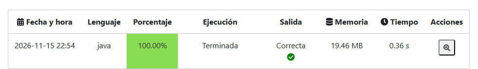
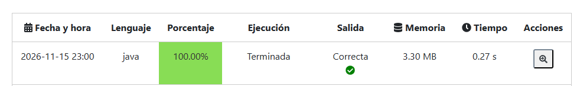
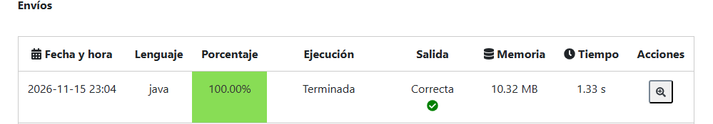
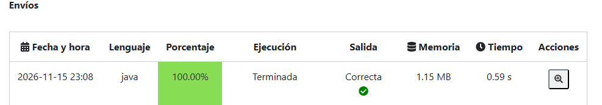
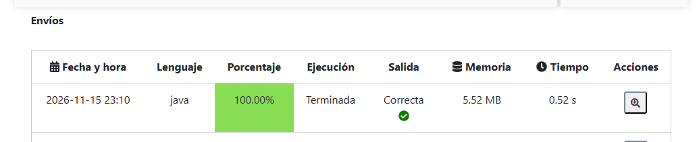
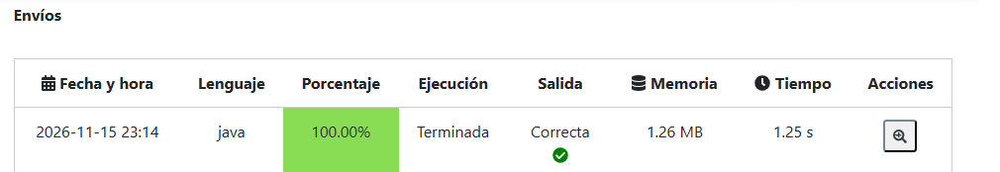
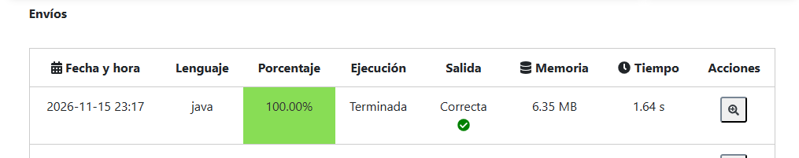
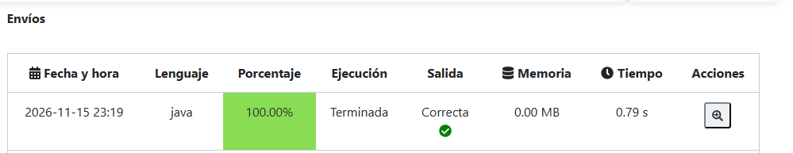

# oscar-ayala-listas-java
Implementación de Listas en Java (U2EP1 Ejercicios Tarea Listas)

## Datos del estudiante
- **Nombre:** Oscar Manuel Ayala Ortiz
- **Grupo:** GTID244
- **Asignatura:** Estructuras de datos
- **Docente:** Gabriel Barrón Rodríguez
- **Fecha:** 15 de noviembre de 2026
- **Lenguaje:** Java, compilado y ejecutado por consola

## Ejercicios resueltos

| N.º | Problema | Tipo de lista | Carpeta |
|---|---|---|---|
| 1 | Formados en la cafetería | Simple (dos colas) | `ejercicio1_FormadosEnLaCafeteria` |
| 2 | cuenta_letras_al_vector | Simple | `ejercicio2_CuentaLetrasAlVector` |
| 3 | Comprando agua | Simple | `ejercicio3_ComprandoAgua` |
| 4 | Inserción en Lista Enlazada | Doble | `ejercicio4_InsercionEnListaEnlazada` |
| 5 | Supermercado | Doble (ordenada) | `ejercicio5_Supermercado` |
| 6 | Cajas de dulces | Simple | `ejercicio6_CajasDeDulces` |
| 7 | Cuadro de Honor | Simple (ordenada) | `ejercicio7_CuadroDeHonor` |
| 8 | Derdenio y sus Estructuras de Datos | Doble | `ejercicio8_Derdenio` |

En todos se usa una lista propia (clase `Nodo` y clase `ListaSimple` o `ListaDoble`). No se usa LinkedList, ArrayList ni Vector.

## 1. Formados en la cafetería

**Problema:** hay dos filas, alumnos y trabajadores. Cuando toca atender, pasa primero un trabajador; si no hay trabajadores, pasa un alumno.

**Lista:** simple. Cada fila es una cola: se agrega al final y se atiende al inicio. Con referencias a `cabeza` y `cola`, las dos operaciones son O(1) y no hace falta regresar hacia atrás.

**Algoritmo:** con `LLEGA` se hace `insertarFinal` en la lista que corresponda. Con `ATIENDE` se revisa si la lista de trabajadores está vacía: si no, se hace `eliminarInicio` en ella; si sí, en la de alumnos. Al eliminar, si la lista se queda sin nodos, también se pone `cola = null`. Se lee con `BufferedReader` porque puede haber hasta 200,000 eventos.

**Evidencia en omegaUp (100%):**



## 2. cuenta_letras_al_vector

**Problema:** contar cuántas veces aparece cada letra de una cadena y mostrar los 26 conteos y las letras que sí aparecen.

**Lista:** simple. Se crea una lista con 26 nodos, de la `a` a la `z`, cada uno con su contador. Solo se recorre en un sentido y en orden alfabético.

**Algoritmo:** por cada carácter de la cadena se busca su nodo recorriendo desde la cabeza y se incrementa su contador. Al final se recorre la lista una vez para imprimir los contadores y otra para imprimir "La letra x aparece n veces" de las que tienen más de 0.

**Evidencia en omegaUp (100%):**



## 3. Comprando agua

**Problema:** de N precios distintos, imprimir el más barato.

**Lista:** simple, porque solo se necesita guardar los precios y recorrerlos una vez.

**Algoritmo:** se guardan los precios con `insertarFinal`. Para buscar el menor, se supone que el primero es el menor y se recorre el resto, actualizando el menor cada vez que se encuentra uno más bajo.

**Evidencia en omegaUp (100%):**



## 4. Inserción en Lista Enlazada

**Problema:** insertar un `-1` antes de cada número impar, decir cuántos se insertaron e imprimir la lista con el formato `a -> b -> NULL`.

**Lista:** doble. Para insertar *antes* de un nodo hay que modificar al nodo anterior. En la doble cada nodo ya conoce a su `anterior`, así que no hay que llevar otro puntero aparte.

**Algoritmo:** se recorre la lista y cuando el valor es impar se llama a `insertarAntes`:
1. El nuevo apunta con `siguiente` al actual y con `anterior` al previo.
2. El actual apunta con `anterior` al nuevo.
3. Si había previo, su `siguiente` apunta al nuevo; si no, el nuevo es la nueva `cabeza`.

Después se avanza al siguiente nodo original, así el `-1` (que también es impar) no se vuelve a revisar.

**Evidencia en omegaUp (100%):**



## 5. Supermercado

**Problema:** imprimir el ticket con los productos de mayor a menor precio, numerados, y al final el total.

**Lista:** doble y ordenada. Cada producto se inserta en su lugar; para meterlo en medio hace falta el nodo anterior, que la doble ya tiene.

**Algoritmo:** se busca el primer nodo con precio menor o igual al nuevo y se inserta antes de él. Hay cuatro casos: lista vacía, va al inicio (es el más caro), va al final (es el más barato) o va en medio. Luego se recorre desde la cabeza imprimiendo `numero | producto | precio` y sumando el total. Los precios se imprimen sin ceros de sobra (23.60 → 23.6, 23.00 → 23), como en el ejemplo.

**Evidencia en omegaUp (100%):**



## 6. Cajas de dulces

**Problema:** de N cajas en fila, encontrar la mayor cantidad de dulces sumando K cajas seguidas.

**Lista:** simple, porque la ventana solo avanza hacia adelante.

**Algoritmo (ventana deslizante con dos punteros):**
1. Se suman las primeras K cajas; el puntero `fin` queda en la caja K + 1.
2. Mientras `fin` no sea null: se suma la caja de `fin`, se resta la de `inicio` y se avanzan los dos punteros. Se guarda la suma más grande.

Así cada caja se visita una sola vez en lugar de volver a sumar K cajas cada vez.

**Evidencia en omegaUp (100%):**



## 7. Cuadro de Honor

**Problema:** imprimir en orden alfabético a los alumnos con promedio de 9.5 o más.

**Lista:** simple y ordenada, porque solo se necesita imprimir de principio a fin.

**Algoritmo:** solo se insertan los alumnos con promedio ≥ 9.5. Para insertar en orden: si la lista está vacía o el nombre va antes que la cabeza, se vuelve la nueva cabeza. Si no, se avanza mientras el **siguiente** nodo vaya antes alfabéticamente, porque en una lista simple hay que pararse en el nodo anterior al lugar donde se inserta. Los nombres se leen por línea completa porque tienen espacios.

**Evidencia en omegaUp (100%):**



## 8. Derdenio y sus Estructuras de Datos

**Problema:** juntar dos listas ordenadas de menor a mayor en una sola de mayor a menor.

**Lista:** doble. Se mezclan las dos listas en una nueva de menor a mayor, y luego se imprime **desde la cola hacia la cabeza** usando el enlace `anterior`. Así sale de mayor a menor sin tener que voltear la lista.

**Algoritmo (mezcla):** se ponen dos punteros, uno en cada lista. Mientras las dos tengan nodos, se copia el menor de los dos y se avanza en esa lista. Lo que sobre de una de ellas se copia tal cual, porque ya está ordenado.

**Evidencia en omegaUp (100%):**



## Pruebas realizadas

Cada ejercicio se probó con los ejemplos de omegaUp y con casos propios: uno normal, uno límite y uno grande.

| Ejercicio | Caso límite | Caso grande |
|---|---|---|
| 1 | Una sola persona | 200,000 eventos (0.6 s) |
| 2 | Cadena vacía | 1000 letras |
| 3 | Una sola marca | 10,000 precios |
| 4 | Lista vacía y un solo impar | Impares seguidos |
| 5 | Un solo producto | Productos con el mismo precio |
| 6 | N = 1 y K = N | 1000 cajas |
| 7 | Promedio justo de 9.5 y nadie en el cuadro | — |
| 8 | N = 1 | N = 100,000 (0.6 s) |

## Cómo compilar y ejecutar

Cada ejercicio está en su carpeta. Por ejemplo, para el ejercicio 1:

```
cd ejercicio1_FormadosEnLaCafeteria
javac *.java
java Main
```

Después se escribe la entrada (o se pega) y, si el programa lee hasta el fin de la entrada (ejercicio 4), se termina con **Ctrl+Z** y Enter.

También se puede usar un archivo de entrada:

```
java Main < entrada.txt
```

## Cómo subirlo a omegaUp

omegaUp solo acepta un archivo. Se copian las clases `Nodo` y `ListaSimple` (o `ListaDoble`) dentro de `Main.java`, debajo de la clase `Main`, y se les quita la palabra `public` (solo `Main` puede ser `public`). Los `import` van hasta arriba del archivo.
